# 🛡️ SOC Home Lab: Threat Detection, Telemetry Engineering & Incident Response with Wazuh SIEM

> **Tác giả:** Lê Việt Bắc  
> **Hồ sơ năng lực (Portfolio):** SOC Analyst Intern / Junior Blue Team  
> **Repository:** [github.com/bac1234556/SOC-Home-Lab](https://github.com/bac1234556/SOC-Home-Lab)  
> **Trọng tâm kỹ thuật:** SIEM Architecture • Endpoint Telemetry (Sysmon & WinEvent) • Detection Engineering (Sigma to Wazuh) • Adversary Emulation (Atomic Red Team) • MITRE ATT&CK Mapping • Active Response Mechanics

---

## 📖 1. Tổng quan Dự án (Project Overview & Scope)

Dự án này xây dựng một mô hình **Trung tâm Điều hành An ninh (Security Operations Center - SOC) thu nhỏ**, mô phỏng toàn bộ quy trình phát hiện, điều tra và ứng phó sự cố trong môi trường mạng doanh nghiệp thực tế. 

Hệ thống sử dụng **Wazuh SIEM/XDR** làm trung tâm điều phối, thu thập và phân tích dữ liệu telemetry thời gian thực từ máy trạm **Windows 11 Endpoint**, được tăng cường năng lực giám sát sâu ở tầng nhân (kernel level) thông qua **Microsoft Sysmon** và chính sách kiểm toán nâng cao **Windows Advanced Audit Policy**.

### Mục tiêu cốt lõi (Core Objectives):
1. **Kiến trúc & Vận hành SIEM:** Triển khai và liên kết các thành phần Wazuh Manager, Indexer, Filebeat và Dashboard trên nền tảng Linux ảo hóa.
2. **Khai thác & Chuẩn hóa Telemetry:** Cấu hình thu thập đa kênh sự kiện Windows (Security, Sysmon, PowerShell Operational) để giám sát các hành vi nguy hiểm.
3. **Detection Engineering:** Chuyển đổi tư duy săn tìm mối đe dọa từ quy chuẩn cộng đồng (**Sigma Rule**) sang quy tắc tùy chỉnh trên SIEM (**Wazuh Custom XML Ruleset**), đồng thời phân biệt giữa cảnh báo sự kiện đơn lẻ và quy tắc tương quan đa sự kiện (Correlation Rule).
4. **Adversary Emulation (Purple Teaming):** Sử dụng framework **Atomic Red Team** để mô phỏng có kiểm soát các kỹ thuật tấn công theo chuẩn **MITRE ATT&CK** (`T1110`, `T1059.001`, `T1562.004`), đóng kín vòng lặp giữa bên tấn công và phòng thủ.
5. **Nghiên cứu Phản ứng Tự động (Active Response):** Phân tích luồng dữ liệu STDIN/JSON của daemon `wazuh-execd` và giải quyết bài toán không tương thích trường dữ liệu (Field Mismatch) trên Windows EventChannel.

---

## 🏗️ 2. Kiến trúc Hệ thống & Bảng Phân bổ Tài nguyên (Lab Architecture & Inventory)

### Sơ đồ luồng dữ liệu (Data Pipeline)

```mermaid
graph LR
    A[Atomic Red Team / Attacker] -->|Simulate RDP Brute-force & PowerShell| B(Windows 11 Endpoint - baclev)
    B -->|WinEventLog 4625/4688 + Sysmon EID 1/3 + PS 4104| C[Wazuh Agent Service]
    C -->|Encrypted TCP 1514 / 1515| D[Wazuh Manager - Amazon Linux]
    D -->|Decoder & Custom Rules 100500/100501/100602/100710| E[Wazuh Indexer]
    E -->|Search & Visualization| F[Wazuh Dashboard]
```



### Bảng phân bổ tài nguyên & vai trò (Lab Inventory)

| Hostname / Node | Hệ điều hành | Địa chỉ IP | Vai trò & Phần mềm cài đặt |
| :--- | :--- | :--- | :--- |
| **wazuh-server** | Amazon Linux 2023 (OVA/VM) | `10.10.10.10` | Wazuh Manager, Wazuh Indexer, Wazuh Dashboard, Filebeat |
| **baclev** | Windows 11 Pro (x64) | `10.10.10.100` / `10.10.20.x` | Endpoint nạn nhân, Wazuh Agent (v4.14.8), Sysmon (SwiftOnSecurity config), Invoke-AtomicRedTeam |

---

## 🔌 3. Triển khai Thu thập Telemetry (Telemetry Ingestion & Agent Enrollment)

Để giám sát toàn diện hành vi trên Endpoint `baclev`, hệ thống cấu hình kết hợp 3 kênh log then chốt:

1. **Windows Security Event Log (`Security`):**
   * Giám sát xác thực: Event ID `4624` (Logon Success), `4625` (Logon Failure - Logon Type 10 RDP & Type 3 Network).
   * Giám sát tạo tiến trình: Event ID `4688` kèm tùy chọn ghi nhận đầy đủ dòng lệnh (*Include command line in process creation events*).
2. **Microsoft-Windows-Sysmon/Operational:**
   * Cài đặt Sysmon với cấu hình chuẩn hóa nhằm giám sát tiến trình hệ thống (Event ID `1`), kết nối mạng ra ngoài (Event ID `3`), thay đổi khóa Registry khởi động cùng hệ thống (Event ID `12`, `13`).
3. **Microsoft-Windows-PowerShell/Operational:**
   * Bật Script Block Logging (Event ID `4104`) để bóc tách mã nguồn lệnh PowerShell ngay cả khi bị kẻ tấn công obfuscate hoặc mã hóa Base64.
<details>
<summary><b>📄 Xem trích đoạn cấu hình Telemetry trong ossec.conf (Click để mở)</b></summary>

```xml
<!-- Windows Security EventChannel -->
<localfile>
  <location>Security</location>
  <log_format>eventchannel</log_format>
</localfile>

<!-- Microsoft Sysmon EventChannel -->
<localfile>
  <location>Microsoft-Windows-Sysmon/Operational</location>
  <log_format>eventchannel</log_format>
</localfile>

<!-- PowerShell Script Block Logging EventChannel -->
<localfile>
  <location>Microsoft-Windows-PowerShell/Operational</location>
  <log_format>eventchannel</log_format>
</localfile>

  
*Hình 1: Wazuh Dashboard xác nhận Agent `001 - baclev` (`10.10.10.100`) đã đăng ký thành công và duy trì trạng thái kết nối thời gian thực (Active).*

---

## 🛠️ 4. Kỹ thuật Phát hiện (Detection Engineering)

### 4.1. Phân tích bài toán: Tấn công RDP Brute-Force (`T1110.001`)
Khi kẻ tấn công dò quét mật khẩu từ xa qua Remote Desktop Protocol (cổng 3389), Windows ghi nhận hàng loạt sự kiện Event ID `4625` kèm theo `LogonType: 10` (RemoteInteractive). 

* **Hạn chế của Rule mặc định:** Wazuh gán Rule ID `60106` và `60122` ở mức cảnh báo trung bình (Level 5). Điều này không đủ để kích hoạt chuông cảnh báo khẩn cấp hoặc thực hiện chặn IP tự động.
* **Chiến lược phát hiện:** 
  * Xây dựng **Base Rule (100500)**: Bắt chính xác sự kiện `4625` và nâng lên Level 10.
  * Xây dựng **Correlation Rule (100501)**: Đếm tần suất (frequency = 5 lần trong timeframe = 60 giây từ cùng một IP) để phân biệt giữa người dùng nội bộ gõ nhầm mật khẩu với một cuộc tấn công brute-force có chủ đích.

### 4.2. Chuyển đổi từ Sigma Rule sang Wazuh Custom XML Rule

* **Sigma Base Rule:** Được lưu tại [`rules/sigma_rdp_bruteforce.yml`](rules/sigma_rdp_bruteforce.yml)
* **Wazuh XML Ruleset:** Được lưu tại [`rules/local_rules.xml`](rules/local_rules.xml)

```xml
<!-- Trích đoạn Rule 100500 & 100501 từ /var/ossec/etc/rules/local_rules.xml -->
<group name="local,windows,security,">

  <!-- Base Rule: Bắt sự kiện 4625 -->
  <rule id="100500" level="10">
    <if_sid>60106, 60122</if_sid>
    <field name="win.system.eventID">^4625$</field>
    <description>SOC Lab Alert: Phat hien dang nhap RDP/Network that bai tu IP $(win.eventdata.ipAddress)</description>
    <mitre>
      <id>T1110</id>
    </mitre>
    <group>authentication_failed,pci_dss_10.2.4,pci_dss_10.2.5,</group>
  </rule>

  <!-- Correlation Rule: Phát hiện Brute-force tần suất cao -->
  <rule id="100501" level="12" frequency="5" timeframe="60">
    <if_matched_sid>100500</if_matched_sid>
    <same_field>win.eventdata.ipAddress</same_field>
    <description>SOC Lab Alert: Tấn công RDP Brute-Force liên tục (>= 5 thất bại / 60s) từ IP $(win.eventdata.ipAddress)</description>
    <mitre>
      <id>T1110</id>
      <id>T1110.001</id>
    </mitre>
    <group>authentication_failed,attack_t1110,</group>
  </rule>

</group>
```

### 4.3. Kiểm thử logic quy tắc với `wazuh-logtest`
Quy tắc 100500 được đưa qua công cụ kiểm thử phân tích cú pháp tĩnh và động `wazuh-logtest` trên Wazuh Manager:

  
*Hình 2: Bộ giải mã Windows JSON decoder bóc tách chính xác `win.eventdata.ipAddress: 10.10.30.50`, `eventID: 4625` và kích hoạt Rule 100500 ở Phase 3 kèm thẻ MITRE T1110.*

---

## 🧪 5. Mô phỏng Tấn công & Kiểm thử Đối kháng (Adversary Emulation)

Nhằm xác minh độ phủ phòng thủ trên máy trạm Windows 11 `baclev`, dự án sử dụng framework **Atomic Red Team** (`Invoke-AtomicRedTeam`).

* **Hướng dẫn kịch bản chi tiết:** [`simulation/atomic_test_walkthrough.md`](simulation/atomic_test_walkthrough.md)

### 5.1. Kiểm tra điều kiện tiên quyết (Prerequisites Check)
Trước khi chạy tấn công, tiến hành kiểm tra điều kiện môi trường cho kỹ thuật **T1059.001** (PowerShell):
```powershell
Invoke-AtomicTest T1059.001 -GetPrereqs
```

  
*Hình 3: Kết quả kiểm tra điều kiện tiên quyết cho các bài test T1059.001 (đặc biệt là bài test 15 và 16 tạo tham số dòng lệnh mã hóa Base64 -EncodedCommand).*

### 5.2. Kết quả Săn tìm Mối đe dọa (Threat Hunting Telemetry trên Wazuh Dashboard)
Sau khi kích hoạt các kịch bản kiểm thử, toàn bộ dữ liệu telemetry được Wazuh Agent chuyển tiếp về Wazuh Indexer và trực quan hóa:

* **Tổng số sự kiện ghi nhận (24h):** **2,960** sự kiện.
* **Cảnh báo mức độ nghiêm trọng cao (Level 12+):** **367** cảnh báo.
* **Thống kê xác thực:** **5** lượt Authentication failure và **11** lượt Authentication success.
* **Top 10 kỹ thuật MITRE ATT&CK được nhận diện:**
  * `Windows Command Scripting`
  * `Ingress Tool Transfer`
  * `Command and Scripting Interpreter`
  * `Account Discovery`
  * `PowerShell`
  * `Valid Accounts`
  * `Password Guessing`

  
*Hình 4: Wazuh Threat Hunting Dashboard với số liệu thực tế ghi nhận đợt bùng phát telemetry trong quá trình giả lập tấn công.*

---

## 🗺️ 6. Ma trận Độ phủ MITRE ATT&CK & Phân tích Lỗ hổng (Coverage Matrix & Gap Analysis)

### 6.1. Bảng ánh xạ Quy tắc phát hiện (Detection Mapping)

| STT | Mô tả Hành vi Phát hiện | Wazuh Rule ID | Nguồn Log Telemetry | MITRE Tactic | MITRE Technique | Trạng thái Kiểm thử |
| :---: | :--- | :---: | :--- | :--- | :--- | :---: |
| 1 | Đăng nhập thất bại / RDP Brute-Force | `100500` / `100501` | WinEvent Security (4625) | Credential Access | **T1110** (Brute Force) | **Đã kiểm thử thực tế** |
| 2 | Can thiệp cấu hình tường lửa qua `netsh.exe` | `100602` | Sysmon (Event ID 1) | Defense Evasion | **T1562.004** (Firewall Modification) | **Phân tích tĩnh & Rule** |
| 3 | Thực thi kịch bản PowerShell mã hóa Base64 | `100710` | Sysmon (Event ID 1) / PS (4104) | Execution | **T1059.001** (PowerShell) | **Đã kiểm thử qua Atomic** |
| 4 | Thay đổi trạng thái Service / Vô hiệu hóa phòng thủ | `60106` | Windows System / SCM | Defense Evasion | **T1562** (Impair Defenses) | **Rule mặc định mở rộng** |

*File Layer JSON sử dụng trực tiếp trên công cụ Navigator:* [`mitre-attack/attack_navigator_layer.json`](mitre-attack/attack_navigator_layer.json)

  
*Hình 5: Ma trận MITRE ATT&CK Navigator trực quan hóa các kỹ thuật đã được phủ bởi quy tắc phát hiện và đối soát qua kiểm thử.*

### 6.2. Phân tích Khoảng trống An ninh (Gap Analysis)
* **Initial Access:** Chưa phủ kỹ thuật kết nối RDP thành công từ các IP công cộng bất thường (Event ID `4624` Logon Type 10 kết hợp đối chiếu Threat Intel feed).
* **Persistence:** Cần bổ sung rule phát hiện tạo Scheduled Task ẩn danh (`schtasks.exe` / Event ID `4698`) và can thiệp khóa Registry Run/RunOnce (Sysmon Event ID `12`, `13`).
* **Privilege Escalation:** Cần giám sát việc leo quyền và thêm tài khoản vào nhóm `Administrators` (Event ID `4728`, `4732`).

---

## ⚙️ 7. Phản ứng Tự động (Active Response): Thiết kế & Khắc phục Lỗi Thực tế

*File cấu hình trích đoạn:* [`configs/ossec-active-response.conf`](configs/ossec-active-response.conf)

### 7.1. Hiện trạng triển khai: Mẫu kiến trúc (Architectural Prototype)
Dự án đã nghiên cứu và cấu hình khối `win-firewall-drop` trên Wazuh Manager để tự động khóa IP tấn công khi nổ Rule 100500 trong thời gian 180 giây.

### 7.2. Phân tích nguyên nhân kỹ thuật (Field Mismatch Root Cause)
Trong quá trình thử nghiệm thực tế trên môi trường Windows 11, một vấn đề tương thích sâu đã được ghi nhận:
1. Script mặc định `netsh.exe` của Wazuh Agent yêu cầu tham số địa chỉ IP phải nằm ở trường tĩnh `srcip` trong đối tượng JSON truyền qua STDIN từ daemon `wazuh-execd`.
2. Trên Windows EventChannel hiện đại (Windows 10/11, Server 2022), sự kiện 4625 không sinh ra `srcip` ở root level mà đóng gói trong cấu trúc lồng nhau: `data.win.eventdata.ipAddress`.
3. Do sự bất đồng tên trường, kịch bản mặc định nhận giá trị rỗng (`NULL`) và không thể tự tạo rule tường lửa `netsh advfirewall`.

### 7.3. Giải pháp Kiến trúc đề xuất (Production Wrapper Solution)
Để khắc phục triệt để, giải pháp sản xuất là triển khai một kịch bản wrapper bằng PowerShell (`wazuh-active-response-wrapper.ps1`):
* Đọc luồng STDIN JSON từ tiến trình `wazuh-execd`.
* Trích xuất chính xác trường `parameters.alert.data.win.eventdata.ipAddress`.
* Kiểm tra danh sách trắng (Whitelist các IP nội bộ / Domain Controller để tránh DoS).
* Gọi cmdlet `New-NetFirewallRule -DisplayName "Wazuh-Block-$IP" -Direction Inbound -Action Block -RemoteAddress $IP`.

---

## 🛠️ 8. Hướng dẫn Khắc phục sự cố & Bài học Kinh nghiệm (Troubleshooting & Lessons Learned)

| Vấn đề kỹ thuật | Nguyên nhân gốc | Biện pháp xử lý & Khắc phục |
| :--- | :--- | :--- |
| **Wazuh Agent không kết nối (Disconnected)** | Cổng mạng TCP 1514 (Agent communication) và 1515 (Enrollment) bị chặn bởi tường lửa máy chủ Linux. | Mở port trên Wazuh Manager: `firewall-cmd --add-port={1514,1515}/tcp --permanent && firewall-cmd --reload`. |
| **Không sinh log dòng lệnh khi chạy process** | Mặc định Windows chỉ bật Event 4688 mà không ghi Command Line. | Bật chính sách: `Local Group Policy Editor` $\rightarrow$ `Computer Configuration` $\rightarrow$ `Administrative Templates` $\rightarrow$ `System` $\rightarrow$ `Audit Process Creation` $\rightarrow$ Bật `Include command line in process creation events`. |
| **Invoke-AtomicRedTeam bị chặn thực thi** | Chính sách ExecutionPolicy của PowerShell trên Windows 11 chặn script tải từ Internet. | Chạy lệnh `Set-ExecutionPolicy -Scope Process -ExecutionPolicy Bypass -Force` trước khi nạp module. |
| **Quy tắc Wazuh không ăn khớp (No Alert)** | Tên trường trong XML viết hoa/thường không khớp với bộ decoder JSON. | Sử dụng công cụ `/var/ossec/bin/wazuh-logtest` để xem chính xác tên trường sau Phase 2 trước khi định nghĩa `<field>`. |

---

## 📁 9. Cấu trúc Kho lưu trữ (Repository Structure)

```plaintext
SOC-Home-Lab/
├── README.md                              # Tài liệu chính của dự án SOC Home Lab
├── LICENSE                                # Giấy phép mã nguồn mở MIT License
├── .gitignore                             # Cấu hình loại trừ file rác, cache và log nhạy cảm
├── configs/
│   └── ossec-active-response.conf         # Đoạn cấu hình trích đoạn Active Response (Wazuh Manager)
├── rules/
│   ├── sigma_rdp_bruteforce.yml           # Quy tắc phát hiện chuẩn Sigma (Base Rule)
│   └── local_rules.xml                    # Bộ quy tắc XML tùy chỉnh (Wazuh Custom Rules: 100500, 100501, 100602, 100710)
├── simulation/
│   └── atomic_test_walkthrough.md         # Tài liệu nhật ký thực thi mô phỏng tấn công Atomic Red Team
├── mitre-attack/
│   └── attack_navigator_layer.json        # Layer cấu hình ma trận MITRE ATT&CK Navigator v5
└── evidence/                              # 5 ảnh chụp màn hình minh chứng kỹ thuật thực tế
    ├── agent-active.png                   # Minh chứng Agent 001 baclev Active trên Wazuh
    ├── logtest-100500.png                 # Minh chứng chạy wazuh-logtest nổ Rule 100500
    ├── atomic-powershell.png              # Minh chứng chạy Invoke-AtomicTest T1059.001
    ├── wazuh-threat-hunting-dashboard.png # Minh chứng Dashboard 2,960 events & 367 alerts
    └── mitre-navigator.png                # Minh chứng trực quan hóa ma trận MITRE ATT&CK
```

---

## 👤 Thông tin Liên hệ (Contact)

* **Họ và tên:** Lê Việt Bắc
* **Chuyên ngành:** Công nghệ Thông tin / An toàn Thông tin
* **Trường đào tạo:** Trường Đại học CMC
* **GitHub Profile:** [github.com/bac1234556](https://github.com/bac1234556)
* **Email:** bacleviet43@gmail.com
