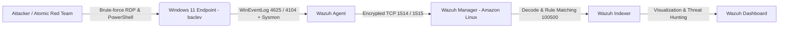

# 🛡️ SOC Home Lab: Threat Detection & Incident Response with Wazuh SIEM
> **Tác giả:** Lê Việt Bắc  
> **Repository:** [github.com/bac1234556/SOC-Home-Lab](https://github.com/bac1234556/SOC-Home-Lab)  
> **Trọng tâm:** SIEM Deployment • Log Analysis • Detection Engineering (Sigma to Wazuh) • MITRE ATT&CK Mapping • Adversary Emulation (Atomic Red Team)

---

## 📖 1. Tổng quan Dự án (Executive Summary)
Dự án này xây dựng một mô hình **Trung tâm Điều hành An ninh (SOC) thu nhỏ**, mô phỏng toàn bộ vòng đời phát hiện và ứng phó sự cố thực tế trong doanh nghiệp. Hệ thống sử dụng **Wazuh SIEM/XDR** làm trung tâm thu thập và phân tích dữ liệu telemetry từ máy trạm **Windows 11 Endpoint** (được tăng cường bởi **Sysmon** và **Windows Security Event Log**).

**Các kết quả cốt lõi đạt được trong Lab:**
* Triển khai và vận hành kiến trúc Wazuh SIEM (Manager, Indexer, Dashboard) trên nền tảng ảo hóa Amazon Linux.
* Tích hợp Wazuh Agent và Sysmon trên endpoint Windows 11 (`baclev`), thiết lập luồng thu thập log thời gian thực (Security Event, Sysmon, PowerShell Operational).
* Thực hành **Detection Engineering**: Viết quy tắc phát hiện chuẩn **Sigma** và biên dịch sang **Wazuh Custom XML Rule (`Rule ID: 100500`)** để bắt hành vi tấn công dò mật khẩu RDP (Event ID `4625`).
* Ánh xạ năng lực phòng thủ lên ma trận **MITRE ATT&CK Framework** và thực hiện kiểm thử độ phủ (Purple Teaming) bằng bộ công cụ **Atomic Red Team** (`T1110`, `T1059.001`).
* Nghiên cứu cơ chế phản ứng tự động (**Active Response**) và phân tích kiến trúc luồng dữ liệu JSON của tiến trình `wazuh-execd`.

---

## 🏗️ 2. Kiến trúc Hệ thống & Bảng Inventory (Lab Architecture)

### Sơ đồ luồng dữ liệu (Data Pipeline)


### Bảng phân bổ tài nguyên (Lab Inventory)

| Thành phần / Hostname | Hệ điều hành | Địa chỉ IP | Vai trò & Công cụ cài đặt |
| :--- | :--- | :--- | :--- |
| **wazuh-server** | Amazon Linux 2023 (OVA) | 10.10.10.10 | Wazuh Manager, Indexer, Dashboard, Filebeat |
| **baclev** | Windows 11 Pro (x64) | 10.10.20.x | Endpoint nạn nhân, Wazuh Agent, Sysmon, Atomic Red Team |

---

## 🔌 3. Triển khai SIEM & Thu thập Telemetry (Log Ingestion)
Endpoint Windows 11 (`baclev`) được cấu hình thu thập các kênh sự kiện quan trọng nhất phục vụ săn tìm mối đe dọa (Threat Hunting):
* **Windows Security Log**: Giám sát sự kiện xác thực đăng nhập thành công (4624) và thất bại (4625).
* **Microsoft-Windows-Sysmon/Operational**: Giám sát hành vi tạo tiến trình (Event ID 1), kết nối mạng (Event ID 3) và thay đổi Registry.
* **Microsoft-Windows-PowerShell/Operational**: Giám sát thực thi kịch bản ẩn thông qua Script Block Logging (Event ID 4104).


---

## 🛠️ 4. Kỹ thuật Phát hiện (Detection Engineering)

### 4.1. Bài toán phát hiện: Tấn công RDP Brute-Force (T1110)
Khi kẻ tấn công thực hiện dò mật khẩu qua giao thức Remote Desktop (RDP) hoặc SMB, hệ điều hành Windows sẽ sinh ra hàng loạt sự kiện Event ID 4625 (*An account failed to log on*). Mặc định, Wazuh ghi nhận từng sự kiện đơn lẻ ở mức cảnh báo trung bình (Rule ID: 60122 / 60106). Mục tiêu là xây dựng một quy tắc tùy chỉnh (Custom Rule) nâng mức cảnh báo lên mức nguy hiểm cao (Level 10) để phục vụ cảnh báo tức thời và kích hoạt phản ứng.

### 4.2. Chuyển đổi từ Sigma Rule sang Wazuh XML Rule
* **File Sigma chuẩn:** Xem tại [`rules/sigma_rdp_bruteforce.yml`](rules/sigma_rdp_bruteforce.yml)
* **File Wazuh Custom Rule (`/var/ossec/etc/rules/local_rules.xml`):** Xem tại [`rules/local_rules.xml`](rules/local_rules.xml)

```xml
<group name="windows,security,authentication_failures,">
  <rule id="100500" level="10">
    <if_sid>60106, 60122</if_sid>
    <field name="win.system.eventID">^4625$</field>
    <description>SOC Lab Alert: Phát hiện hành vi đăng nhập thất bại Windows / RDP Brute-force (T1110)</description>
    <mitre>
      <id>T1110</id>
    </mitre>
  </rule>
</group>
```

### 4.3. Kiểm chứng quy tắc với wazuh-logtest
Trước khi đưa vào vận hành thực tế, quy tắc 100500 được kiểm thử qua công cụ `wazuh-logtest` trên Wazuh Manager để xác nhận bộ giải mã (Decoder) bóc tách chính xác trường dữ liệu `win.eventdata.ipAddress` và `win.eventdata.targetUserName` ở Phase 3.


---

## 🧪 5. Mô phỏng Tấn công & Kiểm thử Độ phủ (Adversary Emulation)
Để xác minh hệ thống hoạt động hiệu quả trước các hành vi tấn công thực tế (Đóng vòng lặp Detect - Simulate), dự án sử dụng framework **Atomic Red Team** chạy trực tiếp trên máy nạn nhân `baclev`.

### 5.1. Thực thi kịch bản kiểm thử (T1059.001 & T1110)
Chi tiết các bước cài đặt và chạy lệnh được lưu tại [`simulation/atomic_test_walkthrough.md`](simulation/atomic_test_walkthrough.md).


### 5.2. Kết quả Giám sát & Săn tìm mối đe dọa trên Wazuh Dashboard
Sau khi chạy các kịch bản mô phỏng tấn công và thử nghiệm xác thực, toàn bộ telemetry đã được Wazuh Manager thu nhận, phân tích và trực quan hóa trên giao diện Threat Hunting:
* **Tổng số sự kiện ghi nhận (24h):** 2,960 sự kiện.
* **Cảnh báo mức độ nghiêm trọng cao (Level 12+):** 367 cảnh báo.
* **Sự kiện xác thực:** Ghi nhận 5 lượt *Authentication failure* và 11 lượt *Authentication success*.
* **Phân bổ MITRE ATT&CK:** Nhận diện rõ nét các kỹ thuật *Ingress Tool Transfer*, *Windows Command Scripting*, *PowerShell*, *Account Discovery* và *Password Guessing*.


---

## 🗺️ 6. Ma trận Độ phủ MITRE ATT&CK & Phân tích Lỗ hổng (Coverage Matrix)

### 6.1. Bảng ánh xạ Quy tắc phát hiện (Detection Coverage)

| STT | Mô tả Quy tắc Phát hiện | Wazuh Rule ID | Nguồn Log (Log Source) | MITRE Tactic | MITRE Technique |
| :---: | :--- | :---: | :--- | :--- | :--- |
| 1 | Phát hiện đăng nhập thất bại liên tục (RDP Brute-force) | 100500 | Windows Security (Event 4625) | Credential Access | T1110 - Brute Force |
| 2 | Phát hiện thay đổi trạng thái dịch vụ / Tắt công cụ bảo vệ | 60106 | Windows System / SCM | Defense Evasion | T1562 - Impair Defenses |
| 3 | Phát hiện thực thi lệnh mạng can thiệp tường lửa (netsh.exe) | 100602 | Sysmon (Event ID 1) / Security (4688) | Defense Evasion | T1562.004 - Disable or Modify System Firewall |
| 4 | Phát hiện thực thi kịch bản PowerShell đáng ngờ / EncodedCommand | 100710 | PowerShell Operational (Event 4104) | Execution | T1059.001 - PowerShell |

*(File cấu hình Layer cho công cụ MITRE ATT&CK Navigator được lưu tại: [`mitre-attack/attack_navigator_layer.json`](mitre-attack/attack_navigator_layer.json))*


### 6.2. Phân tích Lỗ hổng (Gap Analysis) & Lộ trình phát triển
Trong thực tế vận hành SOC, việc xác định các vùng chưa được che phủ (Gaps) giúp ưu tiên nguồn lực viết rule theo mức độ rủi ro:
* **Initial Access (Chưa phủ):** Bổ sung rule giám sát kết nối RDP thành công từ các dải IP ngoại lai (Event ID 4624 Logon Type 10 kết hợp Event ID 1149).
* **Persistence (Chưa phủ):** Bổ sung rule giám sát hành vi tạo Scheduled Task ẩn (Event ID 4698) và can thiệp khóa Registry Run/RunOnce (Sysmon Event ID 12, 13).
* **Privilege Escalation (Chưa phủ):** Bổ sung rule giám sát việc thêm tài khoản vào nhóm Quản trị viên cục bộ (Event ID 4732).

---

## ⚙️ 7. Bài học Kinh nghiệm Kỹ thuật (Lessons Learned: Active Response Troubleshooting)
Trong quá trình triển khai cơ chế phản ứng tự động (Active Response) sử dụng kịch bản `win-firewall-drop` (`netsh.exe`) trên Windows 11 để tự động khóa IP khi nổ Rule 100500, một vấn đề kỹ thuật thực tế đã được phát hiện và mổ xẻ:

* **Phân tích nguyên nhân gốc (Root Cause Analysis):**
  * Tiến trình `wazuh-execd` trên Windows Agent hoạt động bình thường (đã xác minh qua `ossec.log` không có lỗi Active response disabled).
  * Tuy nhiên, kịch bản mặc định `netsh.exe` của Wazuh yêu cầu trường chuẩn hóa tĩnh là `srcip` bên trong gói tin JSON truyền xuống từ Manager. Trong khi đó, bộ giải mã mặc định của Windows EventChannel cho sự kiện 4625 lại lưu trữ địa chỉ IP nguồn trong trường động `data.win.eventdata.ipAddress`. Sự bất đồng tên trường (Field Mismatch) kết hợp với cơ chế bảo vệ của môi trường ảo hóa Windows 11 khiến script mặc định không trích xuất được IP để tạo rule tường lửa tự động.
* **Giải pháp Kiến trúc đề xuất (Engineering Solution):**
  * Xây dựng một Custom Active Response Script viết bằng Python hoặc PowerShell đóng vai trò Wrapper trên Windows Agent, trực tiếp đọc luồng STDIN JSON từ `wazuh-execd`, bóc tách chính xác trường `parameters.alert.data.win.eventdata.ipAddress` và thực thi lệnh `New-NetFirewallRule`.

---

📫 **Liên hệ:** Lê Việt Bắc - Sinh viên Công nghệ Thông tin, Trường Đại học CMC.
