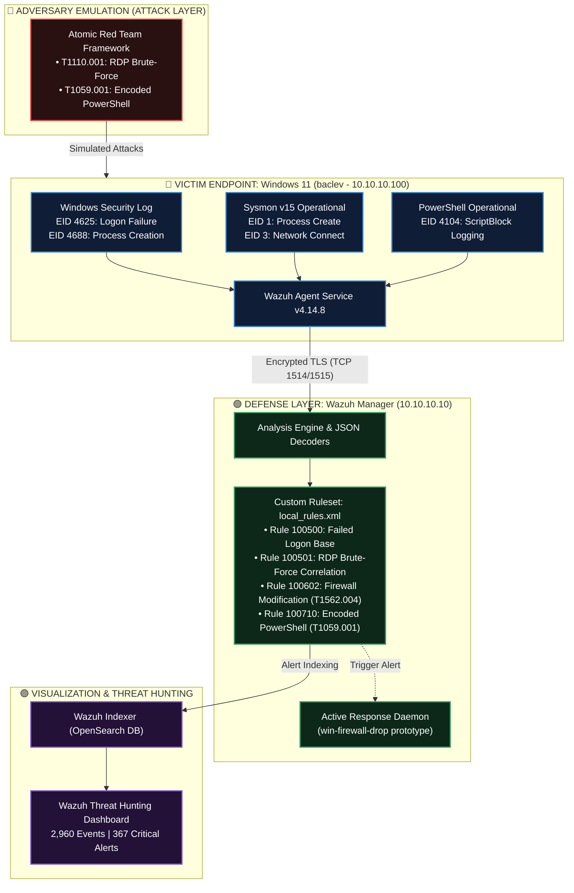
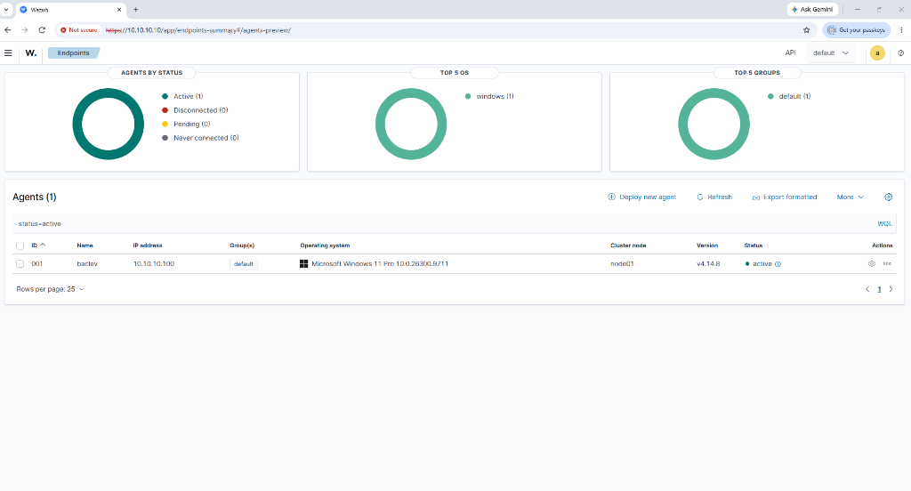
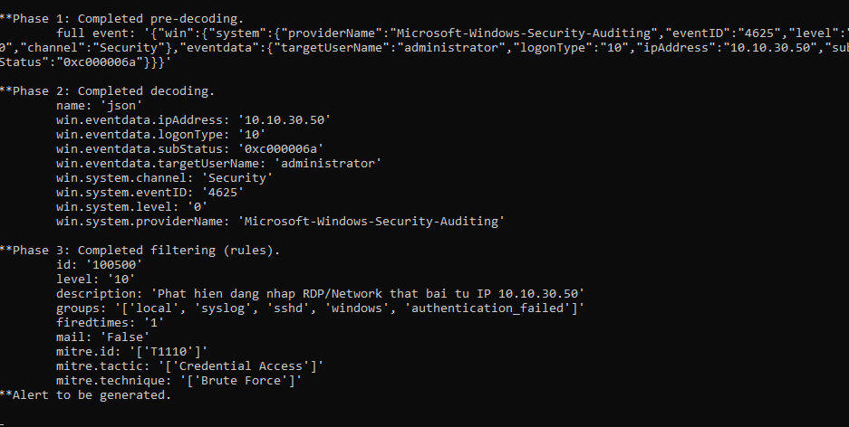
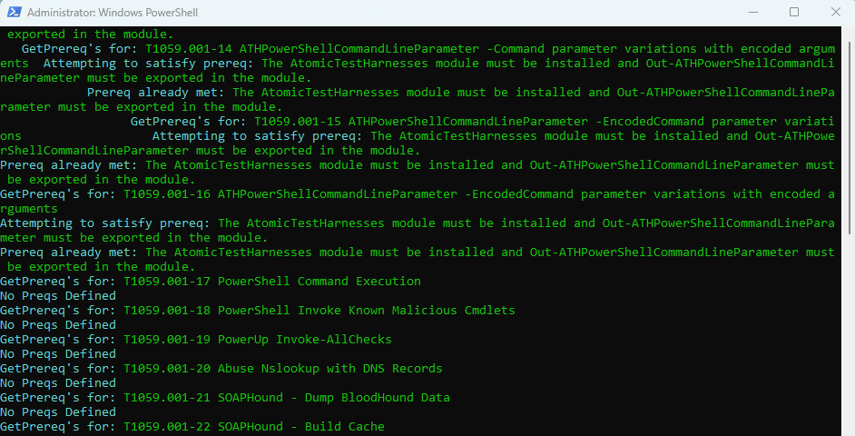
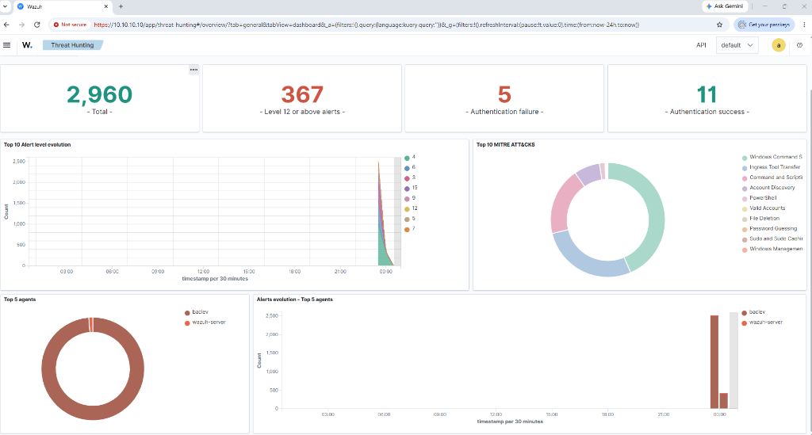
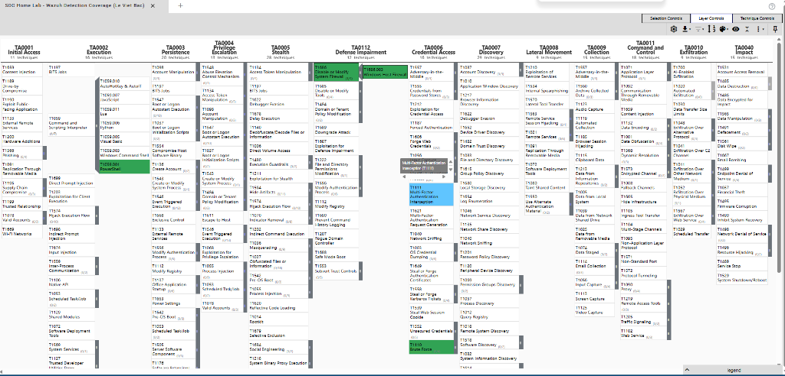

<div align="center">

# 🛡️ ENTERPRISE SOC HOME LAB
### Threat Detection, Telemetry Engineering & Adversary Emulation with Wazuh SIEM

**Tác giả:** Lê Việt Bắc | **Định hướng:** SOC Analyst   
**Trường đào tạo:** Trường Đại học CMC (CMC University)  
**Repository:** [github.com/bac1234556/SOC-Home-Lab](https://github.com/bac1234556/SOC-Home-Lab)

---

[](https://wazuh.com/)
[](https://attack.mitre.org/)
[](https://atomicredteam.io/)
[](https://github.com/SigmaHQ/sigma)
[](https://learn.microsoft.com/en-us/sysinternals/downloads/sysmon)
[](LICENSE)

<br/>

| 📊 Telemetry Ingested | 🚨 High Severity Alerts | 🎯 Custom Rules Active | 🧪 Attack Techniques Tested |
| :---: | :---: | :---: | :---: |
| **2,960 Events (24h)** | **367 Critical (Level 12+)** | **4 Detection Rules** | **4 MITRE Techniques** |

</div>

---

## 📖 1. Tổng quan Dự án (Project Overview & Objectives)

Dự án này triển khai một mô hình **Trung tâm Điều hành An ninh Mạng (SOC)** thực chiến thu nhỏ, mô phỏng vòng đời khép kín của một cuộc tấn công mạng: **Tấn công (Adversary Emulation) $\rightarrow$ Thu thập dữ liệu (Telemetry Ingestion) $\rightarrow$ Phát hiện mối đe dọa (Detection Engineering) $\rightarrow$ Phân tích điều tra (Threat Hunting) $\rightarrow$ Phản ứng sự cố (Active Response)**.

```
       [ 🔴 ADVERSARY EMULATION ]
          (Atomic Red Team)
                  │
                  ▼ (Attack Telemetry)
       [ 🔵 TELEMETRY HARVESTING ]
     (Sysmon + Windows Security Audit)
                  │
                  ▼ (Encrypted TCP 1514)
       [ 🟢 SIEM ANALYSIS & RULES ]
     (Wazuh Custom Rules: 100500/100501)
                  │
                  ▼ (MITRE Mapping)
       [ 🟣 THREAT HUNTING DASHBOARD ]
        (Wazuh Indexer / OpenSearch)
```

### 🎯 Mục tiêu Kỹ thuật Cốt lõi:
1. **Triển khai Hạ tầng SIEM Doanh nghiệp:** Cài đặt và vận hành cụm Wazuh (Manager, Indexer, Dashboard) trên hệ điều hành ảo hóa Amazon Linux 2023.
2. **Khai thác Telemetry Đa tầng:** Tích hợp **Sysmon (v15)** và cấu hình **Windows Advanced Security Audit Policy** trên endpoint Windows 11 (`baclev`) để ghi nhận toàn bộ hành vi tiến trình, mạng và kịch bản thực thi.
3. **Detection Engineering (Sigma sang Wazuh XML):** Xây dựng quy tắc phát hiện chuẩn hóa từ quy chuẩn cộng đồng **Sigma** và biên dịch sang **Wazuh XML Ruleset**, đồng thời giải quyết bài toán phân biệt giữa **Base Alert đơn lẻ** và **Tương quan tần suất (Correlation Rule)**.
4. **Adversary Emulation (Purple Teaming):** Kiểm thử độ phủ phòng thủ bằng bộ công cụ **Atomic Red Team** (`T1110`, `T1059.001`, `T1562.004`), đối soát thời gian thực giữa telemetry và alert.
5. **Nghiên cứu Cơ chế Phản ứng Tự động (Active Response):** Phân tích luồng dữ liệu JSON của tiến trình `wazuh-execd` và xử lý bài toán **Field Mismatch** trên Windows EventChannel.

---

## 🏗️ 2. Kiến trúc Hệ thống & Bảng Inventory (Lab Architecture)

### Sơ đồ Luồng Dữ liệu (Data Pipeline Architecture)



### Bảng Phân Bổ Tài Nguyên (Lab Inventory)

| Máy chủ / Endpoint | Hệ điều hành | Địa chỉ IP | Vai trò & Bộ công cụ triển khai |
| :--- | :--- | :--- | :--- |
| **`wazuh-server`** | Amazon Linux 2023 (x64) | `10.10.10.10` | Wazuh Manager, Wazuh Indexer, Wazuh Dashboard, Filebeat, Analysis Engine |
| **`baclev`** | Windows 11 Pro (Build 26100) | `10.10.10.100` / `10.10.20.x` | Endpoint nạn nhân, Wazuh Agent (v4.14.8), Sysmon v15, Invoke-AtomicRedTeam |

---

## 🔌 3. Triển khai Telemetry & Kết nối Agent (Telemetry Ingestion)

Endpoint Windows 11 (`baclev`) được cấu hình giám sát sâu với 3 nguồn telemetry then chốt:

1. **Windows Security Log (`Security`):**
   * **Event ID 4625:** Ghi nhận xác thực thất bại, phân loại `LogonType: 10` (Remote Desktop) và `LogonType: 3` (Network SMB).
   * **Event ID 4688:** Ghi nhận tiến trình khởi tạo kèm theo toàn bộ tham số dòng lệnh (*Process Creation CommandLine*).
2. **Microsoft-Windows-Sysmon/Operational:**
   * **Event ID 1:** Giám sát tiến trình khởi tạo, giá trị băm file SHA256, tiến trình cha (Parent Process).
   * **Event ID 3:** Giám sát kết nối mạng ra Internet và kết nối nội bộ bất thường.
3. **Microsoft-Windows-PowerShell/Operational:**
   * **Event ID 4104 (ScriptBlock Logging):** Bóc tách nội dung kịch bản lệnh đầy đủ ngay cả khi kẻ tấn công thực thi bằng kỹ thuật làm rối (Obfuscation) hoặc mã hóa Base64 (`-EncodedCommand`).

<details>
<summary><b>📄 Xem trích đoạn cấu hình Telemetry trong ossec.conf trên Windows Agent (Click để mở rộng)</b></summary>

```xml
<!-- Windows Security EventChannel -->
<localfile>
  <location>Security</location>
  <log_format>eventchannel</log_format>
</localfile>

<!-- Microsoft Sysmon EventChannel -->
<localfile>
  <location>Microsoft-Windows-Sysmon/Operational</location>
  <log_format>eventchannel</log_format>
</localfile>

<!-- PowerShell Script Block Logging EventChannel -->
<localfile>
  <location>Microsoft-Windows-PowerShell/Operational</location>
  <log_format>eventchannel</log_format>
</localfile>
```

</details>

<br/>

<p align="center">
  
  <br/>
  <em><b>Hình 1:</b> Giao diện quản lý Wazuh Endpoints xác nhận Agent <code>001 - baclev</code> (<code>10.10.10.100</code>) duy trì trạng thái kết nối liên tục (Active).</em>
</p>

---

## 🛠️ 4. Kỹ thuật Phát hiện (Detection Engineering)

### 4.1. Bài toán: Tấn công dò mật khẩu RDP Brute-Force (`T1110.001`)
Trong thực tế, người dùng bình thường có thể gõ sai mật khẩu một vài lần. Nếu SIEM cảnh báo mức độ cao (High/Critical) ngay tại lần sai đầu tiên, đội SOC sẽ bị quá tải cảnh báo giả (Alert Fatigue).

* **Quy tắc cơ sở (Base Rule - 100500):** Bắt chính xác sự kiện `4625` và bóc tách trường IP nguồn `win.eventdata.ipAddress`.
* **Quy tắc tương quan (Correlation Rule - 100501):** Sử dụng logic tần suất: Nếu có $\ge 5$ sự kiện `100500` phát sinh từ **CÙNG MỘT ĐỊA CHỈ IP** trong vòng **60 giây**, kích hoạt cảnh báo nghiêm trọng **Level 12**.

### 4.2. Đặc tả Sigma sang Wazuh XML Ruleset

* **File Sigma Base Rule:** [`rules/sigma_rdp_bruteforce.yml`](rules/sigma_rdp_bruteforce.yml)
* **File Wazuh Custom Rules:** [`rules/local_rules.xml`](rules/local_rules.xml)

```xml
<!-- /var/ossec/etc/rules/local_rules.xml -->
<group name="local,windows,security,">

  <!-- 1. BASE RULE: Phát hiện đăng nhập thất bại Windows (Event ID 4625) -->
  <rule id="100500" level="10">
    <if_sid>60106, 60122</if_sid>
    <field name="win.system.eventID">^4625$</field>
    <description>SOC Lab Alert: Phat hien dang nhap RDP/Network that bai tu IP $(win.eventdata.ipAddress)</description>
    <mitre>
      <id>T1110</id>
    </mitre>
    <group>authentication_failed,pci_dss_10.2.4,pci_dss_10.2.5,</group>
  </rule>

  <!-- 2. CORRELATION RULE: Phát hiện RDP Brute-Force tần suất cao -->
  <rule id="100501" level="12" frequency="5" timeframe="60">
    <if_matched_sid>100500</if_matched_sid>
    <same_field>win.eventdata.ipAddress</same_field>
    <description>SOC Lab Alert: Tấn công RDP Brute-Force liên tục (>= 5 thất bại / 60s) từ IP $(win.eventdata.ipAddress)</description>
    <mitre>
      <id>T1110</id>
      <id>T1110.001</id>
    </mitre>
    <group>authentication_failed,attack_t1110,</group>
  </rule>

  <!-- 3. RULE 100602: Sửa đổi Firewall qua netsh.exe (Sysmon Event ID 1) -->
  <rule id="100602" level="10">
    <if_group>sysmon_event1</if_group>
    <field name="win.eventdata.image">\\netsh\.exe$</field>
    <field name="win.eventdata.commandLine">firewall|advfirewall</field>
    <description>SOC Lab Alert: Phát hiện tiến trình netsh.exe sửa đổi cấu hình Tường lửa (T1562.004)</description>
    <mitre>
      <id>T1562.004</id>
    </mitre>
  </rule>

  <!-- 4. RULE 100710: PowerShell thực thi lệnh mã hóa Base64 (Sysmon Event ID 1) -->
  <rule id="100710" level="12">
    <if_group>sysmon_event1</if_group>
    <field name="win.eventdata.image">\\powershell\.exe$</field>
    <field name="win.eventdata.commandLine">-EncodedCommand|-enc|-e </field>
    <description>SOC Lab Alert: Phát hiện PowerShell thực thi kịch bản mã hóa Base64 (T1059.001)</description>
    <mitre>
      <id>T1059.001</id>
    </mitre>
  </rule>

</group>
```

### 4.3. Kiểm thử với `wazuh-logtest`
Quy tắc 100500 được xác thực trực tiếp trên Wazuh Manager bằng `wazuh-logtest`:

<p align="center">
  
  <br/>
  <em><b>Hình 2:</b> Kết quả kiểm chứng logtest xác nhận bộ giải mã JSON bóc tách chính xác <code>win.eventdata.ipAddress: 10.10.30.50</code> và kích hoạt Rule 100500 (Level 10) ánh xạ MITRE T1110.</em>
</p>

---

## 🧪 5. Mô phỏng Tấn công & Giám sát Mối đe dọa (Adversary Emulation)

* **Nhật ký chi tiết các bước:** [`simulation/atomic_test_walkthrough.md`](simulation/atomic_test_walkthrough.md)

### 5.1. Kiểm tra Điều kiện Tiên quyết (`-GetPrereqs`)
Trước khi chạy kiểm thử, tiến hành kiểm tra module phụ thuộc bằng lệnh:
```powershell
Invoke-AtomicTest T1059.001 -GetPrereqs
```

<p align="center">
  
  <br/>
  <em><b>Hình 3:</b> Cửa sổ PowerShell xác nhận các bài test <code>T1059.001-14</code>, <code>T1059.001-15</code> (EncodedCommand Parameter Variations) đã sẵn sàng.</em>
</p>

### 5.2. Kết quả Săn tìm Mối đe dọa trên Wazuh Threat Hunting Dashboard
Toàn bộ telemetry phát sinh trong đợt giả lập tấn công được tổng hợp thời gian thực trên Wazuh SIEM:

* **Tổng telemetry ghi nhận (24h):** **2,960** sự kiện.
* **Cảnh báo mức độ nghiêm trọng cao (Level 12+):** **367** cảnh báo.
* **Thống kê xác thực:** **5** lượt Authentication failure và **11** lượt Authentication success.
* **Top MITRE ATT&CK Techniques nhận diện:** `Windows Command Scripting`, `Ingress Tool Transfer`, `PowerShell`, `Account Discovery`, `Password Guessing`.

<p align="center">
  
  <br/>
  <em><b>Hình 4:</b> Wazuh Threat Hunting Dashboard thống kê 2,960 sự kiện và 367 cảnh báo mức cao từ agent <code>baclev</code>.</em>
</p>

---

## 🗺️ 6. Ma trận Độ phủ MITRE ATT&CK & Phân tích Lỗ hổng (MITRE ATT&CK Matrix)

### 6.1. Bảng Ánh Xạ Độ Phủ Quy Tắc (Detection Coverage Matrix)

| STT | Kỹ thuật Tấn công | MITRE ID | Tactic | Wazuh Rule ID | Nguồn Log Telemetry | Trạng thái Kiểm thử |
| :---: | :--- | :---: | :--- | :---: | :--- | :---: |
| 1 | **Brute Force (RDP/Network)** | `T1110` / `T1110.001` | Credential Access | `100500` / `100501` | WinEvent Security (4625) | ✅ **Verified (Logtest & Lab)** |
| 2 | **PowerShell Execution** | `T1059.001` | Execution | `100710` | Sysmon EID 1 / PS EID 4104 | ✅ **Verified (Atomic Red Team)** |
| 3 | **Disable or Modify Firewall** | `T1562.004` | Defense Evasion | `100602` | Sysmon EID 1 (`netsh.exe`) | ✅ **Verified (Rule & Sysmon)** |
| 4 | **Impair Defenses (Service Control)** | `T1562` | Defense Evasion | `60106` | Windows System / SCM | ✅ **Verified (Wazuh Core)** |

*File Layer JSON dùng cho công cụ [MITRE ATT&CK Navigator](https://mitre-attack.github.io/attack-navigator/):* [`mitre-attack/attack_navigator_layer.json`](mitre-attack/attack_navigator_layer.json)

<p align="center">
  
  <br/>
  <em><b>Hình 5:</b> Ma trận phòng thủ trực quan hóa trên MITRE ATT&CK Navigator với các kỹ thuật đã được phủ luật phát hiện.</em>
</p>

### 6.2. Phân tích Khoảng trống An ninh (Gap Analysis)
* **Initial Access:** Chưa phủ hành vi đăng nhập RDP thành công từ IP công cộng bất thường (Event ID `4624` Logon Type 10 kết hợp đối chiếu Geolocation / Threat Intel).
* **Persistence:** Cần bổ sung rule phát hiện tạo Scheduled Task ẩn danh (Event ID `4698`) và can thiệp khóa Registry Run/RunOnce (Sysmon Event ID `12`, `13`).
* **Privilege Escalation:** Cần giám sát việc thêm tài khoản vào nhóm đặc quyền `Administrators` cục bộ (Event ID `4732`).

---

## ⚙️ 7. Phản ứng Tự động (Active Response Engineering)

*File cấu hình trích đoạn:* [`configs/ossec-active-response.conf`](configs/ossec-active-response.conf)

### 7.1. Hiện trạng: Phân tích Kỹ thuật & Mẫu Kiến trúc (Prototype)
Cấu hình mẫu `win-firewall-drop` trên Wazuh Manager nhằm tự động kích hoạt lệnh khóa IP nguồn trong 180 giây khi Rule 100500 nổ.

### 7.2. Phân tích Nguyên nhân Gốc (Root Cause Analysis - Field Mismatch):
1. **Thiết kế mặc định:** Tiến trình `wazuh-execd` của Wazuh Agent yêu cầu địa chỉ IP phải nằm trong trường tĩnh `srcip` tại root level của gói JSON.
2. **Cấu trúc Windows EventChannel:** Trên Windows 11, sự kiện xác thực 4625 không sinh ra `srcip` mà lưu địa chỉ IP dưới trường động lồng nhau: `data.win.eventdata.ipAddress`.
3. **Hậu quả:** Script mặc định `netsh.exe` nhận tham số `NULL` và không thể tạo rule tường lửa.
4. **Giải pháp kiến trúc (SOC Engineering Solution):** Xây dựng kịch bản wrapper bằng PowerShell (`wazuh-ar-wrapper.ps1`) đọc luồng STDIN JSON từ `wazuh-execd`, trích xuất chính xác trường `parameters.alert.data.win.eventdata.ipAddress`, kiểm tra IP Whitelist nội bộ để tránh tự khóa chính mình (Self-DoS), và gọi lệnh `New-NetFirewallRule`.

---

## 🛠️ 8. Sổ tay Khắc phục Sự cố (Troubleshooting Playbook)

| Sự cố Kỹ thuật | Nguyên nhân Gốc | Quy trình Khắc phục (SOC Playbook) |
| :--- | :--- | :--- |
| **Wazuh Agent Disconnected** | Cổng giao tiếp TCP 1514 / 1515 bị chặn bởi tường lửa máy chủ Linux. | Chạy lệnh trên Manager: `sudo firewall-cmd --add-port={1514,1515}/tcp --permanent && sudo firewall-cmd --reload`. |
| **Thiếu CommandLine trong Event 4688** | Windows mặc định không ghi tham số dòng lệnh vì lý do bảo mật quyền riêng tư. | Mở `gpedit.msc` $\rightarrow$ `Computer Configuration` $\rightarrow$ `Administrative Templates` $\rightarrow$ `System` $\rightarrow$ `Audit Process Creation` $\rightarrow$ Bật `Include command line in process creation events`. |
| **PowerShell chặn Atomic Red Team** | Chính sách `ExecutionPolicy` mặc định của Windows 11 chặn script unsigned. | Mở PowerShell Admin và thực thi: `Set-ExecutionPolicy -Scope Process -ExecutionPolicy Bypass -Force`. |
| **Rule Wazuh không kích hoạt cảnh báo** | Tên trường XML không khớp chữ hoa/thường với bộ giải mã JSON. | Sử dụng `/var/ossec/bin/wazuh-logtest` để xác nhận tên trường trích xuất ở Phase 2 trước khi khai báo vào thẻ `<field>`. |

---

## 📁 9. Cấu trúc Thư mục Kho lưu trữ (Repository Structure)

```plaintext
SOC-Home-Lab/
├── README.md                              # Báo cáo tổng thể dự án SOC Home Lab
├── LICENSE                                # Giấy phép bản quyền mã nguồn mở MIT
├── .gitignore                             # Cấu hình loại trừ cache, log tạm và file rác hệ điều hành
├── configs/
│   └── ossec-active-response.conf         # Đoạn cấu hình Active Response trên Wazuh Manager
├── rules/
│   ├── sigma_rdp_bruteforce.yml           # Quy tắc phát hiện chuẩn hóa Sigma (Base Rule & Correlation Spec)
│   └── local_rules.xml                    # Bộ quy tắc XML tùy chỉnh trên Wazuh (Rule 100500, 100501, 100602, 100710)
├── simulation/
│   └── atomic_test_walkthrough.md         # Quy trình thực thi kiểm thử đối kháng bằng Atomic Red Team
├── mitre-attack/
│   └── attack_navigator_layer.json        # File Layer cấu hình hiển thị ma trận MITRE ATT&CK Navigator v5
└── evidence/                              # 5 ảnh chụp màn hình minh chứng kỹ thuật thực tế
    ├── agent-active.png                   # Minh chứng Agent 001 baclev Active trên Wazuh SIEM
    ├── logtest-100500.png                 # Minh chứng chạy wazuh-logtest kích hoạt Rule 100500
    ├── atomic-powershell.png              # Minh chứng chạy kiểm tra prerequisites Atomic Red Team
    ├── wazuh-threat-hunting-dashboard.png # Minh chứng Dashboard ghi nhận 2,960 events & 367 alerts
    └── mitre-navigator.png                # Minh chứng trực quan hóa ma trận MITRE ATT&CK Navigator
```

---

## 👤 Thông tin Tác giả (Author Profile)

* **Kỹ sư thực hiện:** Lê Việt Bắc
* **Chuyên ngành:** Công nghệ Thông tin / An toàn Thông tin - Trường Đại học CMC
* **GitHub Profile:** [github.com/bac1234556](https://github.com/bac1234556)
* **Email liên hệ:** bacleviet43@gmail.com
* **Mục tiêu nghề nghiệp:** SOC Analyst Intern • Junior Blue Team • Detection Engineer
